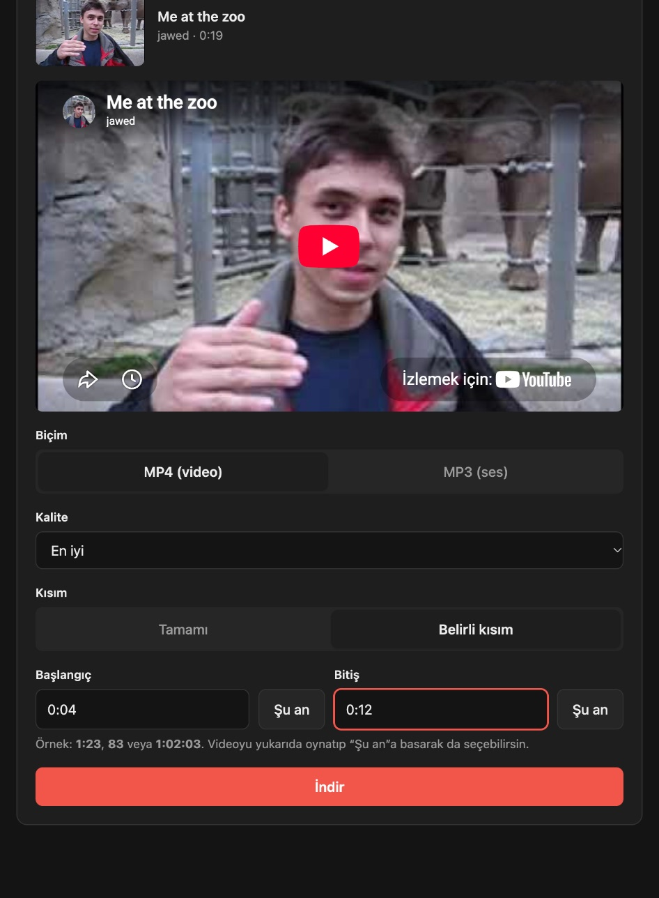

# YT İndirici

YouTube videolarını **MP4** ya da **MP3** olarak indiren, kendi bilgisayarında çalışan küçük bir uygulama. İster videonun tamamını, ister sadece bir kısmını indirebilirsin (örneğin 1:20–1:35 arası).

Mac'te de Windows'ta da çalışır. Arayüzü tarayıcıda açılır ama bütün işlem senin bilgisayarında olur. Reklam yok, takip yok, hesap yok.

<p align="center">
  
</p>

## İndir

En son sürümü **[Releases](https://github.com/emretenoz/yt-indirici/releases/latest)** sayfasından indirebilirsin:

| Sistem | Dosya |
|---|---|
| 🍎 Mac | `YT-Indirici-Mac-vX.Y.Z.zip` |
| 🪟 Windows | `YT-Indirici-Windows-vX.Y.Z.zip` |

## Özellikler

- **MP4:** En iyi kalite, 2160p, 1440p, 1080p, 720p, 480p veya 360p. Seçenekler videonun desteklediği kalitelere göre listelenir.
- **MP3:** 320, 192 veya 128 kbps.
- **Belirli kısmı indirme:** Başlangıç ve bitişi saniyesi saniyesine seçebilirsin. Zamanı `1:23`, `83` ya da `1:02:03` gibi yazabilir veya videoyu sayfada oynatıp **Şu an** düğmesine basabilirsin.
- **Pencere açılmaz:** Çift tıklayınca sadece tarayıcı açılır. Kapatmak için sayfadaki **Uygulamayı kapat** düğmesi var.
- **Kendiliğinden güncellenir:** Her açılışta yt-dlp güncellenir. YouTube bir değişiklik yaptığında genelde uygulamayı yeniden açmak yeterli olur.
- **Kendi alan adınla açılabilir:** Örneğin `http://indir.siten.com`. Aşağıdaki bölüme bak.

## Kurulum

1. Sisteminin zip dosyasını indir ve aç. Çıkan **YT İndirici** klasörünü istediğin bir yere koy, örneğin Belgeler.
2. Uygulamayı aç:
   - **Mac:** `YT İndirici` uygulamasına çift tıkla. İstersen Dock'a sürükleyebilirsin.
   - **Windows:** `YT İndirici.vbs` dosyasına çift tıkla. İstersen sağ tık → **Kısayol oluştur** ile masaüstüne kısayol koyabilirsin.
3. **İlk açılışta** gerekenler kendiliğinden kurulur: [uv](https://github.com/astral-sh/uv), Python 3.12, [yt-dlp](https://github.com/yt-dlp/yt-dlp), ffmpeg ve deno. Bu birkaç dakika sürer ve bir pencere açılır. Sonraki açılışlarda pencere açılmaz, doğrudan tarayıcı açılır.

Bilgisayarında Python kurulu olması gerekmez. Mevcut Python kurulumuna da dokunulmaz; her şey klasördeki `.venv` içine kurulur.

### İlk açılışta güvenlik uyarısı çıkarsa

Uygulama App Store'dan ya da imzalı bir yayıncıdan gelmediği için işletim sistemi ilk seferde uyarı verebilir:

- **Mac:** **Sistem Ayarları → Gizlilik ve Güvenlik** sayfasının en altına in ve "YT İndirici" satırındaki **Yine de Aç** düğmesine bas. Eski macOS sürümlerinde uygulamaya sağ tıkla → **Aç** demen yeterli.
- **Windows:** SmartScreen uyarısında **Ek bilgi → Yine de çalıştır**'a tıkla. Güvenlik duvarı izin isterse **İptal**'e basabilirsin, uygulama yine çalışır.

## Kullanım

1. YouTube bağlantısını yapıştır. Video bilgisi kendiliğinden gelir.
2. **MP4** (video) ya da **MP3** (ses) seç, sonra kaliteyi seç.
3. **Tamamı** ya da **Belirli kısım** seç. Belirli kısım için başlangıç ve bitiş zamanını gir.
4. **İndir**'e bas. Dosya tarayıcının İndirilenler klasörüne gelir. Bir kopyası da uygulama klasöründeki `indirilenler/` içine kaydedilir.

Uygulama açıkken tekrar çift tıklarsan ikinci bir kopya açılmaz, sadece tarayıcı sekmesi açılır.

## Kendi alan adınla açmak

`ayarlar.json` dosyasında `alan_adi` boşsa uygulama `http://127.0.0.1:8765` adresinden açılır. Hazır paketlerde bu alan `ytindir.etenoz.com` olarak geliyor. Bu adres DNS'te `127.0.0.1`'e işaret ettiği için her bilgisayarda çalışır ve her bilgisayarı kendisine yönlendirir.

Kendi alan adını kullanmak için:

**1.** DNS sağlayıcında (örneğin Cloudflare) bir kayıt ekle:

| Alan | Değer |
|---|---|
| Type | `A` |
| Name | `indir` (ya da istediğin bir ad) |
| IPv4 address | `127.0.0.1` |
| Proxy status | **Kapalı** (Cloudflare'de gri bulut, "DNS only") |

**2.** `ayarlar.json` dosyasına alan adını yaz:

```json
{
  "alan_adi": "indir.siten.com"
}
```

**3.** Uygulamayı kapatıp yeniden aç. Artık `http://indir.siten.com` adresinden açılır.

Notlar:
- Bu adres internete açılmaz. Sadece uygulamanın çalıştığı bilgisayarda çalışır.
- Adresi `http://` ile yaz. Tarayıcı `https` ile denerse sayfa açılmaz.
- Uygulama alan adı modunda 80 portunu kullanır, böylece adresin sonuna port yazman gerekmez. 80 portu başka bir program tarafından kullanılıyorsa adres `http://indir.siten.com:8765` olur.
- Bazı modemler, bir alan adının `127.0.0.1`'e yönlenmesini güvenlik gereği engeller. Adres açılmazsa sebebi bu olabilir.

## Nasıl çalışır

```
Tarayıcı  ──►  app.py (bu bilgisayarda, yerel web sunucusu)  ──►  yt-dlp  ──►  YouTube
                                                                  └─►  ffmpeg (MP3'e dönüştürme, kesme)
```

- `app.py` Python'un standart kütüphanesiyle yazılmış küçük bir web sunucusu. Arayüz `index.html` dosyasında.
- Sunucu **sadece bu bilgisayardan** gelen isteklere yanıt verir. Aynı ağdaki başka cihazlardan gelen istekler ve tanınmayan alan adlarından gelen istekler `403` ile reddedilir. Bu, başka web sitelerinin tarayıcın üzerinden uygulamaya erişmesini de (DNS rebinding) engeller.
- İndirmeyi [yt-dlp](https://github.com/yt-dlp/yt-dlp) yapar. Dönüştürme ve kesme için [imageio-ffmpeg](https://github.com/imageio/imageio-ffmpeg) paketindeki ffmpeg, YouTube'un JavaScript doğrulaması için [deno](https://deno.com) kullanılır. Hepsi PyPI'dan kurulur.

## Proje dosyaları

| Dosya | Ne işe yarar |
|---|---|
| `app.py` | Yerel web sunucusu ve indirme mantığı |
| `index.html` | Arayüz |
| `ayarlar.json` | Alan adı ayarı |
| `requirements.txt` | Python bağımlılıkları |
| `YT İndirici.app` | Mac başlatıcısı (pencere açmadan çalışır). Kaynak kodu `mac-baslatici.applescript` dosyasında. |
| `YT İndirici.vbs` | Windows başlatıcısı (pencere açmadan çalışır) |
| `calistir.sh` | Mac'te kurulum, güncelleme ve başlatma betiği |
| `Baslat (Mac).command`, `Baslat (Windows).bat` | Uygulamayı görünür bir pencerede başlatır. Sorun giderirken hata mesajını görmek için kullanılır. |
| `site-icin/ytindir-yonlendirme-kur.sh` | `etenoz.com/ytindir` yönlendirmesini sunucuya kuran betik |

Mac başlatıcısını yeniden derlemek için:

```bash
osacompile -o "YT İndirici.app" mac-baslatici.applescript
```

Geliştirme sırasında doğrudan çalıştırmak için (tarayıcı açılmasın istersen `NO_BROWSER=1`, farklı port için `PORT=...` kullan):

```bash
.venv/bin/python app.py
```

## Sorun giderme

- **İndirme hata veriyor:** YouTube sık sık değişiklik yapıyor. Uygulamayı **Uygulamayı kapat** düğmesiyle kapatıp yeniden aç; yt-dlp kendiliğinden güncellenir.
- **Hata mesajını görmek istiyorum:** Uygulamayı `Baslat (Mac).command` ya da `Baslat (Windows).bat` ile aç. Pencere açık kalır ve bütün çıktıyı gösterir. Mac'te arka planda çalışırken çıktı `.yt-indirici.log` dosyasına yazılır.
- **Adres açılmıyor:** Uygulamanın açık olduğundan emin ol. Alan adı kullanıyorsan adresi `http://` ile yazdığını kontrol et.

---

Kişisel kullanım içindir. Yalnızca indirme hakkın olan içerikleri indir ve [YouTube Hizmet Şartları](https://www.youtube.com/t/terms)'nı göz önünde bulundur.
